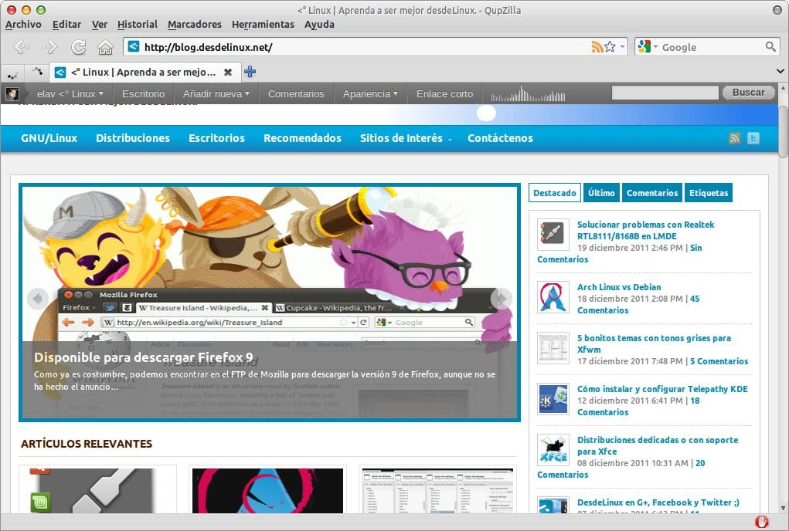
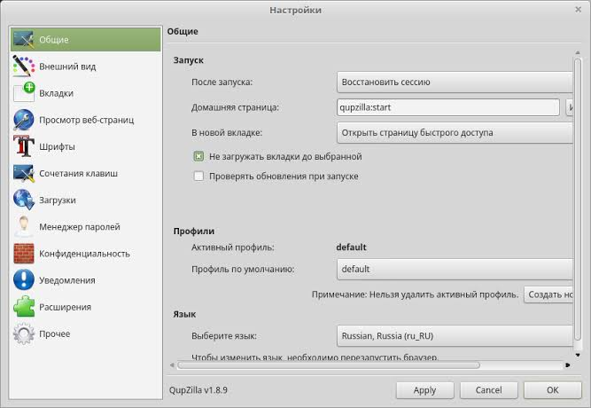

# QupZilla Qt Web Browser Legacy Edition

QupZilla is a cross-platform Qt web browser with tabs, bookmarks, history, plugins, and web content tools.
The project was later renamed Falkon and moved to KDE infrastructure.

[](https://github.com/qupzilla-web-browser/qupzilla-falkon/releases/)

## Project History

QupZilla began as an educational browser project and evolved into a C++ and Qt application.
Its earlier releases used QtWebKit before moving to QtWebEngine.

Since version 3.0, new development continues under the Falkon name.
The QupZilla repository is archived and should be treated as a historical source tree.

## Feature Overview

| Browser area | QupZilla capability | Practical use |
| --- | --- | --- |
| Navigation | Tabs, history, bookmarks, and speed dial | Move through regular browsing tasks |
| Privacy | AdBlock and cookie controls | Reduce unwanted page content |
| Extensions | Browser plugins and userscripts | Extend supported workflows |
| Presentation | Native Qt integration | Match the desktop environment |
| Web content | QtWebKit or QtWebEngine by release | Render supported web pages |
| Productivity | Sidebar, tab tools, and sessions | Keep related pages organized |
| Diagnostics | Web inspector in compatible builds | Examine page behavior |



## Browsing Workspace

The QupZilla web browser provides a traditional desktop layout.
Tabs, bookmarks, history, and a speed dial page support repeated browsing tasks.

A focused browsing routine can use one window for research and another for unrelated pages.
Save a bookmark before closing a page that will be needed later.

### A Review Cycle

1. Open the relevant pages in separate tabs.
2. Keep related pages in a predictable order.
3. Save useful pages as bookmarks.
4. Close stale tabs after recording the next action.
5. Restore the session only when its contents are still relevant.

A saved browser session is a convenience feature.
It is not a substitute for exporting important data or keeping a profile backup.

## Tabs, Bookmarks, and History

Use the sidebar when a list of bookmarks or history entries is easier to scan than a menu.
Tab previews and tab ordering help identify pages in a busy window.

Avoid keeping sensitive pages open indefinitely.
Close sessions and clear stored data according to the requirements of the computer.

## Privacy and Content Controls

QupZilla included a built-in AdBlock plugin and cookie-related controls.
The effectiveness of a filter depends on its lists, the browser engine, and the page.

Review filter changes before applying them to every site.
A blocked resource can affect page layout or a login flow.

- Check the active filter list.
- Test a page with the relevant rule disabled.
- Keep exceptions narrow.
- Recheck after changing the rendering backend.



## Plugins and Userscripts

Plugins add features that are separate from the browser shell.
The archived tree includes plugin-related work and support for userscript icons.

Treat third-party plugins as code with access to browser activity.
Test unfamiliar plugins with a separate profile and remove them when they are no longer needed.

### Extension Review

| Check | Question |
| --- | --- |
| Source | Do you know who maintains the plugin? |
| Compatibility | Does it match the Qt and browser version? |
| Permissions | What pages or data can it access? |
| Recovery | Can it be disabled without losing bookmarks? |
| Maintenance | Is the project still supported? |

A plugin written for the archived QupZilla code may require changes for Falkon.
Do not infer compatibility from a matching plugin name.

## Web Engines

Early QupZilla releases used QtWebKit.
Later releases moved to QtWebEngine, which changed rendering behavior and available APIs.

The project file requires Qt 5.9 or newer in the archived source tree.
A build can still fail if the required WebEngine, OpenSSL, or platform libraries are unavailable.

## Build Requirements

The archived source documentation lists these core requirements:

| Component | Documented requirement | Purpose |
| --- | --- | --- |
| Qt | 5.9 or newer | Application framework |
| QtWebEngine | Included with the Qt installation | Web rendering |
| OpenSSL | Required for supported builds | Secure networking |
| C++ compiler | MSVC, GCC, or Clang toolchain | Compile the browser |
| qmake | Provided by Qt | Generate build files |
| xcb libraries | Required on Linux unless disabled | X11 integration |

KWallet support additionally requires the relevant KDE Frameworks package.
Build requirements vary by operating system and optional plugin selection.

## Building from Source

QupZilla uses a qmake project.
The following example creates a release build from a separate build directory.

```bash
mkdir build
cd build
qmake CONFIG+=release -r ../QupZilla.pro
make -j2
```

The project file is [QupZilla.pro](QupZilla.pro).
The archived build guide is [BUILDING.md](BUILDING.md), which records platform-specific requirements.

### Debug Builds

A debug build can help produce a useful backtrace for a reproducible crash.

```bash
qmake CONFIG+=debug -r ../QupZilla.pro
make -j2
```

Keep debug and release outputs separate.
A debug binary should not be assumed to have the same performance or packaging behavior as a release build.

## Resources and Packaging

The source tree includes platform resources for Windows, macOS, Linux, and Haiku.
The macOS packaging scripts are kept under [mac/create_dmg.sh](mac/create_dmg.sh) and [mac/macdeploy.sh](mac/macdeploy.sh). Build automation also includes [scripts/build-appimage.sh](scripts/build-appimage.sh), [scripts/run_tests.sh](scripts/run_tests.sh), [scripts/cppcheck.sh](scripts/cppcheck.sh), and [scripts/translations_update.sh](scripts/translations_update.sh).

The Linux desktop entry is part of the archived packaging tree when present.
The Flatpak manifest is [org.qupzilla.QupZilla.json](flatpak/org.qupzilla.QupZilla.json).

The application resource collection and Windows resource files are part of the archived packaging tree.
The repository's [falkon.png](falkon.png) records the transition context.

## Release Line

The last QupZilla release was 2.2.6, released on March 13, 2018.
The project then continued under the Falkon name.

The historical release notes are kept in [CHANGELOG](CHANGELOG).
Use Falkon documentation and sources for current development rather than extending the archived QupZilla branch.

## Credits and License

The main developer and project maintainer listed in [AUTHORS](AUTHORS) is David Rosca.
QupZilla is distributed under the GNU General Public License version 3.

The repository also contains [COPYRIGHT](COPYRIGHT) and [LICENSE](LICENSE).
Review those files before redistributing a modified historical build.

## Contributing

For historical code work, describe the exact commit, Qt version, operating system, and rendering backend.
A reproducible sample should not include private browsing data.

Changes intended for active development should be evaluated against Falkon.
The archived QupZilla tree is useful for history, compatibility research, and source archaeology.

## Related Search Terms

qupzilla browser, qupzilla falkon, falkon browser, qupzilla web browser, qupzilla open source browser, browser, qt, qtwebengine, qtwebkit, tabs, adblock, plugins, speed-dial, bookmarks, history
